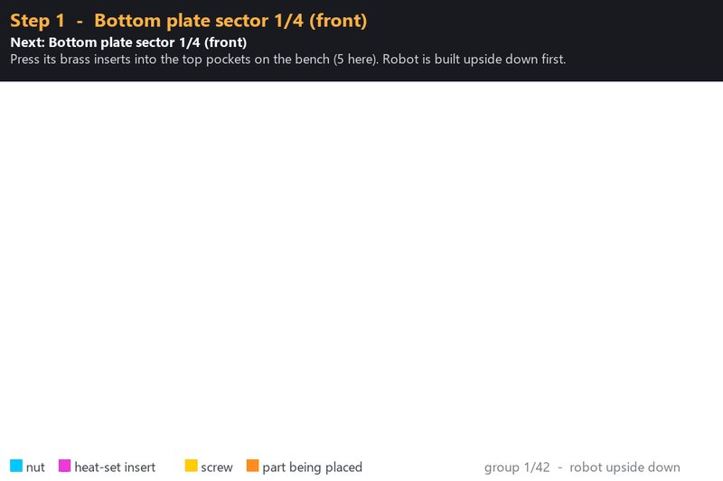
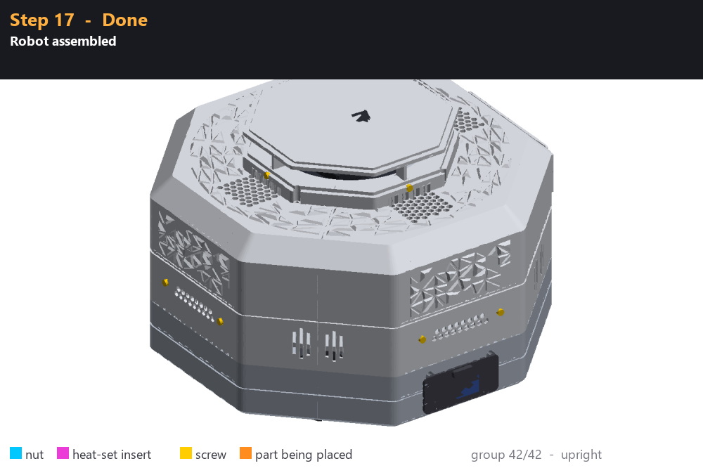
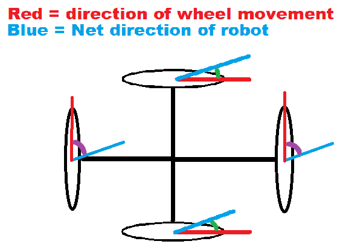

# SLAMurai Autonomous Robot

This project is an open-source implementation of a SLAM (Simultaneous Localization and Mapping) robot.  
All CAD and software is contained within this repo.

---

## Requirement Check

- [x] Omnidirectional movement using 4 dual-layer omniwheels  
- [x] Report odometry accurate to 3cm at 8ft range  
  - Last test: 12/20/2025 with 0.5% error in forward odom, within 3% error for side movement when moving 8ft straight. And 3cm off-center drift when doing pure diagonal.

---

## Features

- Real-time mapping (SLAM Toolbox)  
- Autonomous navigation (Nav2)  
- High-precision stepper-based odometry  

---

# Detailed Robot Design

## Payload

- 4x NEMA 17 Stepper Motors: 0.25kg each = 1.0kg total  
- 4x 60mm Omni wheels: 0.1kg each = 0.4kg total  
- 1x 6000mAh Lipo battery: 0.55kg  
- 1x NVIDIA Jetson Xavier NX: 0.2kg  
- 1x Intel RealSense D455: 0.3kg  
- 3x Chassis plates: 0.3kg total  
- 1x RPLIDAR A1: 0.2kg  

**Total weight: 3.5kg rounded**

---

## Desired robot specs

- Speed: 0.3 m/s  
- Acceleration: 0.5 m/s²  
- Max payload: 3.5 kg  
- Wheels: 60mm (0.0297m radius) omni wheels in 90° configuration  
- Worst case surface: Concrete (Rolling resistance ~0.03)  
- Torque safety factor: 2  

---

# Selecting Motor Parameters

## Required torque

$$
F_{\text{roll}} = \mu \cdot F_{\text{normal}} = 0.03 \cdot 3.5 \text{kg} \cdot 9.81 \text{m/s}^2 = 1.03 \text{N}
$$

$$
F_{\text{accel}} = 3.5 \text{kg} \cdot 0.5 \text{m/s}^2 = 1.75 \text{N}
$$

$$
F_{\text{total}} = 1.03 \text{N} + 1.75 \text{N} = \boxed{2.78 \text{N}}
$$

$$
\tau = F_{\text{total}} \cdot r_{\text{wheel}} = 2.78 \text{N} \cdot 0.0297 \text{m} = \boxed{0.082 \text{Nm}}
$$

This gives us the total torque required for the robot to meet our acceleration target. However, we need the worst-case torque per motor. One might assume it splits evenly between two motors when moving forward/backward or left/right. But could diagonal movement need more?

<p align="center">
  
</p>

If each motor provides torque $T$, the top/bottom motors contribute $2T\cos(\theta)$ and left/right motors $2T\cos(90^\circ - \theta)$, where $\theta$ is the angle of travel. We can solve for $T$ to achieve some total torque $\tau$:

$$
\tau = 2T\cos(\theta) + 2T\cos(90^\circ - \theta) \implies
T = \frac{\tau}{2(\cos(\theta) + \sin(\theta))}
$$

$T$ peaks when $\cos(\theta) + \sin(\theta)$ is minimized. We only consider $0 \leq \theta \leq 90^\circ$ since if the angle is $> 90^\circ$, we switch the direction of the top/bottom motors, yielding an angle $0 \leq \theta \leq 90^\circ$ again. Therefore the maximum of $T$ occurs when $\theta = 0^\circ$ or $90^\circ$. So yes, the worst case is moving purely along the top/bottom or left/right axes, splitting torque evenly:

$$
T = \frac{\tau}{2} = \frac{0.082 \text{Nm}}{2} = \boxed{0.041 \text{Nm}} \cdot 2_{\text{(safety factor)}} \approx \boxed{0.082 \text{Nm worst case per motor}}
$$

---

## Required RPM

$$
\text{RPM} = \frac{\text{Target velocity} \cdot 60}{2\pi r}
= \frac{0.3 \text{m/s} \cdot 60}{2\pi \cdot 0.0297 \text{m}}
\approx \boxed{96.5 \text{RPM}}
$$

---

## Motor & Driver Selection

- NEMA 17 Stepper Motors paired with an Arduino CNC Shield  
- 800 steps/rev (1/4 microstepping)  

Driver:

- A4988 or DRV8825 drivers  
- Up to 2A current capability  

Steppers provide high holding torque and precise positioning without needing external encoders. While they don't have current sensing, the open-loop nature of steppers is offset by our odometry integration.

---

# Battery Selection & Longevity

- Voltage: 12V (3S Lipo)  
- Desired Runtime: 1 hour  

## Total continuous current draw

- Motors: 0.4A each → 1.6A total  
- Jetson Xavier NX: ~15W @ 12V → 1.25A  
- RealSense D455: ~3.5W @ 5V → ~0.35A at 12V side  
- RPLIDAR A1: ~100mA  

$$
I_{\text{total}} \approx 1.6 + 1.25 + 0.35 + 0.1 = \boxed{3.3 \text{A}}
$$

To run for 1 hour:

$$
\text{Capacity} = I_{\text{total}} \cdot \text{Time}
= 3.3 \text{A} \cdot 1 \text{h}
= 3.3 \text{Ah}
= 3300 \text{mAh}
$$

Our 6000mAh battery is more than sufficient, providing a significant safety margin.

---

# Wheel Kinematics

We use inverse kinematics to command motor speeds from a target chassis twist and forward kinematics to compute odometry.

## Inverse Kinematics

$$
\begin{aligned}
\begin{bmatrix}
\omega_1\\
\omega_2\\
\omega_3\\
\omega_4
\end{bmatrix}
&=
\frac{1}{r}
\begin{bmatrix}
\sin(\gamma) & -\cos(\gamma) & -R \\
\sin\left(\frac{\pi}{2} + \gamma\right) & -\cos\left(\frac{\pi}{2} + \gamma\right) & -R \\
\sin(\pi + \gamma) & -\cos(\pi + \gamma) & -R \\
\sin\left(\frac{3\pi}{2} + \gamma\right) & -\cos\left(\frac{3\pi}{2} + \gamma\right) & -R
\end{bmatrix}
\begin{bmatrix}
v_{b,x}\\
v_{b,y}\\
\omega_{b,z}
\end{bmatrix}
\end{aligned}
$$

Where:

- $r = 0.0297\text{m}$  
- $R = 0.1325\text{m}$  
- $\gamma = 0$  

Simplified implementation (motor_controller.ino):

```
v_{Front} = -(v_y + R * omega)
v_{Left} = (v_x - R * omega)
v_{Back} = (v_y - R * omega)
v_{Right} = -(v_x + R * omega)
```

---

## Forward Kinematics

$$
\begin{aligned}
\begin{bmatrix}
v_{b,x}\\
v_{b,y}\\
\omega_{b,z}
\end{bmatrix}
&=
\begin{bmatrix}
0 & 0.5 & 0 & -0.5 \\
-0.5 & 0 & 0.5 & 0 \\
-\frac{1}{4R} & -\frac{1}{4R} & -\frac{1}{4R} & -\frac{1}{4R}
\end{bmatrix}
\begin{bmatrix}
\Delta s_1\\
\Delta s_2\\
\Delta s_3\\
\Delta s_4
\end{bmatrix}
\end{aligned}
$$

---

# Software Implementation

## Motor Control (Arduino)

The motor_controller.ino uses the MobaTools library for smooth, ramped stepper control.

- Serial Parsing: Reads $v_x$, $v_y$, $\omega$ at 40Hz  
- Speed Clamping: Ensures steps/sec never exceed STEPS_PER_SEC_MAX (2000 steps/s)  
- Odometry Integration: Calculates and broadcasts $x$, $y$, yaw over serial  

---

## Navigation Bridge (Python/ROS2)

The main.py node handles the Jetson-to-Arduino communication:

- Command Forwarding: Converts ROS Twist messages into serial strings  
- Odometry Publishing: Publishes nav_msgs/Odometry with appropriate covariances  

---

## Autonomous Navigation (Nav2)

Fully integrated with Nav2.

nav2_params.yaml limits:

```
max_vel_x: 0.25 m/s
max_vel_theta: 1.5 rad/s
```

This ensures reliable stepper performance without missing steps during complex maneuvers.

---

---

# Cortex: Vision-Language Reasoning & Dual-Stream Memory

The cortex (`cortex/`) gives SLAMurai a semantic, time-aware memory of the spaces it drives through, and lets a user ask it questions or send it somewhere by name ("go to where you last saw the dog"). It runs a local vision-language model through Ollama, connected to the robot over rosbridge, so no cloud inference is needed.

## Model

- Custom Ollama model `SLAMurai` (`SLAMurai.mf`), built on **Qwen 3.5 9B** with temperature 0.1
- System prompt: the current camera frame is *the current state*, and memory is *historical evidence*, which keeps stale memories from overriding what the robot currently sees

## Architecture

```
 RealSense RGB ─────┐
 /map + /amcl_pose ─┼─► composite frame (camera | map with pose marker) ──┐
 Nav2 /rosout logs ─┘                                                     │
                                                                          ▼
                       ┌───────────── THINK loop (every ~2 s) ─────────────┐
                       │  VLM ► structured observation                     │
                       │  "[time] Pose [x,y,yaw] | Objects: a(x,y,yaw)...  │
                       │   | Scene: <room type>"                           │
                       └──────────────┬────────────────────────────────────┘
                                      ▼
                     Short-Term Memory (last 8 observations)
                                      │  every 8 observations
                                      ▼  VLM distills ►
                     Long-Term Memory (15 "Key Object Area Index" entries)
                     "[time window] | Key: objects (x,y,yaw) | Env: rooms (x,y,yaw)"
                                      │
 User query ─► CHAT: frame + pose + STM + LTM + Nav2 logs ─► answer
                                      │   (+ NAV_GOAL: navigate(x, y, yaw))
                                      ▼
                     parsed ► PoseStamped ► Nav2 goal (/move_base_simple/goal)
```

## How it works

1. **Perception input.** `slamurai_interface.py` streams the RealSense color image, the occupancy map, the AMCL pose, and Nav2's planner/controller/behavior-tree logs. The camera frame and a map view with the robot's pose and heading are stitched into one image, so the VLM sees what is in front of the robot and where it is in the map at the same time.
2. **Observe (`think`).** About every 2 seconds the VLM writes a structured observation with the time, robot pose, the objects it sees with estimated poses, and a guess of the room type.
3. **Short-term memory.** The 8 most recent observations are kept verbatim.
4. **Long-term memory.** Every 8 observations, the VLM distills short-term memory into one *Key Object Area Index* entry. Each entry keeps the time window, the key objects with their poses, and the room types with the poses where they were seen, and drops transient objects. Up to 15 entries are kept.
5. **Chat and navigate.** A user query is answered with the current frame, pose, map bounds, Nav2 logs, and both memory streams. If the user asks to go somewhere, the VLM looks up its coordinates in memory and appends `NAV_GOAL: navigate(x, y, yaw)`. This is parsed and sent to Nav2 as a goal in the `map` frame. Each chat exchange is also written back into short-term memory.

A terminal "cognitive monitor" shows the latest observation, the short-term log, the long-term archive, and generation time while it runs.

## Current limitations

- **Memory is discrete text.** The robot only remembers what the VLM happens to write down, and detail is lost each time short-term memory is distilled into long-term memory.
- **Fixed capacity.** Long-term memory holds 15 entries, and the oldest is dropped first, so long deployments forget early areas.
- **Coordinates come from the VLM.** Object poses are estimated by the VLM from the image and the pose overlay, not measured geometrically.

**Next step:** replace text memory with continuous embeddings stored per location and merged over each area, so observations from different places and times build into one semantic representation of the space instead of being diluted.

## Demo

SLAMurai was presented live at **ClawCon Michigan (April 2026)**: [talk recording](PASTE_TIMESTAMPED_LINK).

# License

MIT License

---

# Repository layout

```
autonav/       Nav2 launch files, parameters, ROS node (original robot code)
control/       stepper firmware and cmdvel_gui (original robot code, with the robot's controller fixes)
cortex/        LLM interface
robot_cad/     SolidWorks CAD, versions, build scripts
robot_side/    runs on the Jetson: safety gate, Nav2 restart helper, human tools (commission, approve, arm), config. Off unless `safety:=true`
robotlab/      the API: PC library to connect to the robot, drive trials, score, sweep/compare/optimize (profiles/ = per-robot mapping)
recipes/       reusable analysis and run scripts the agent calls or copies
images/        README images
```
